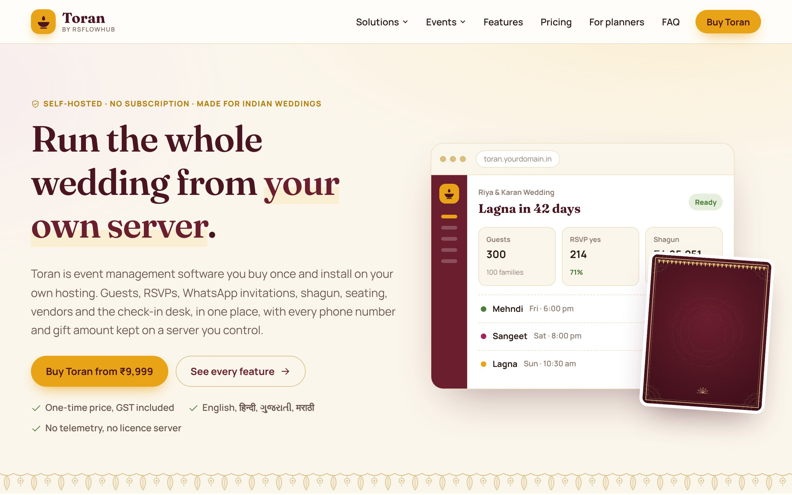
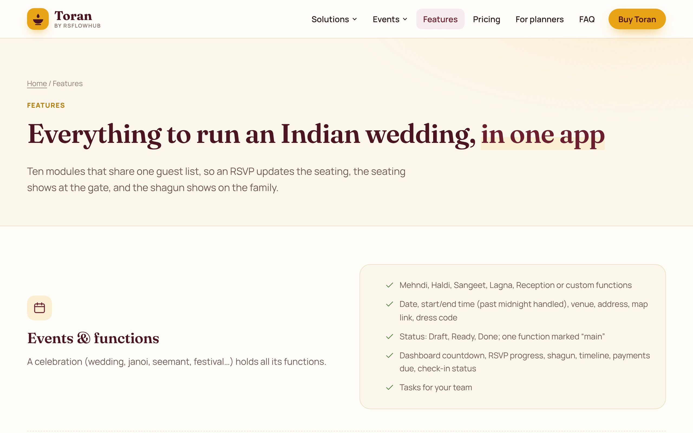
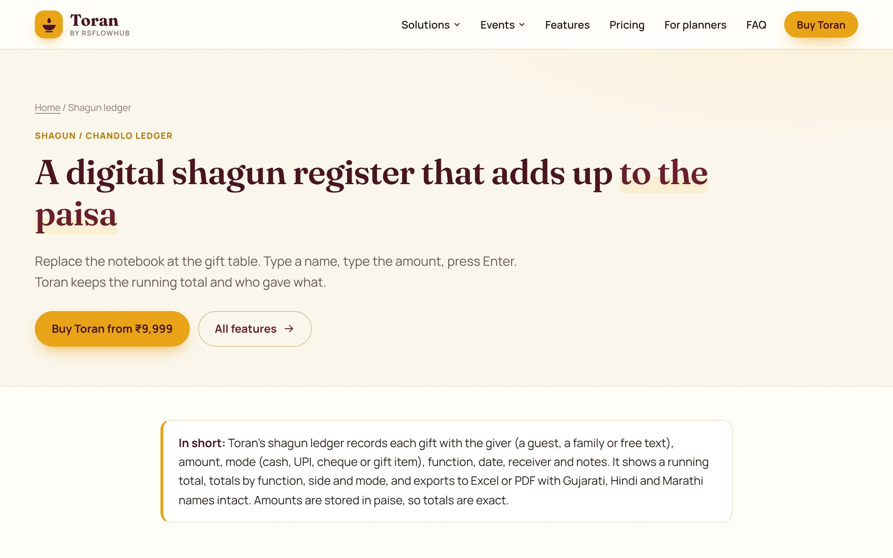
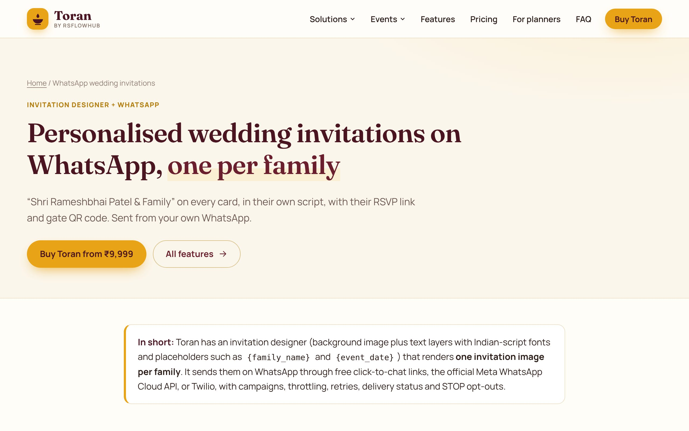
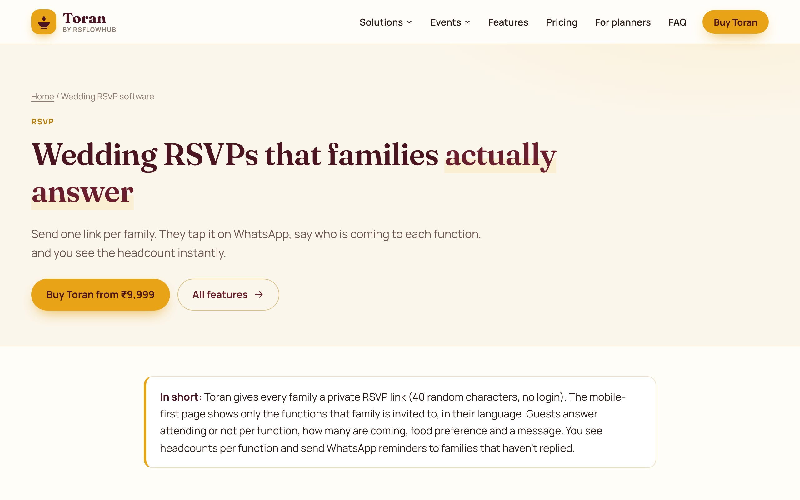
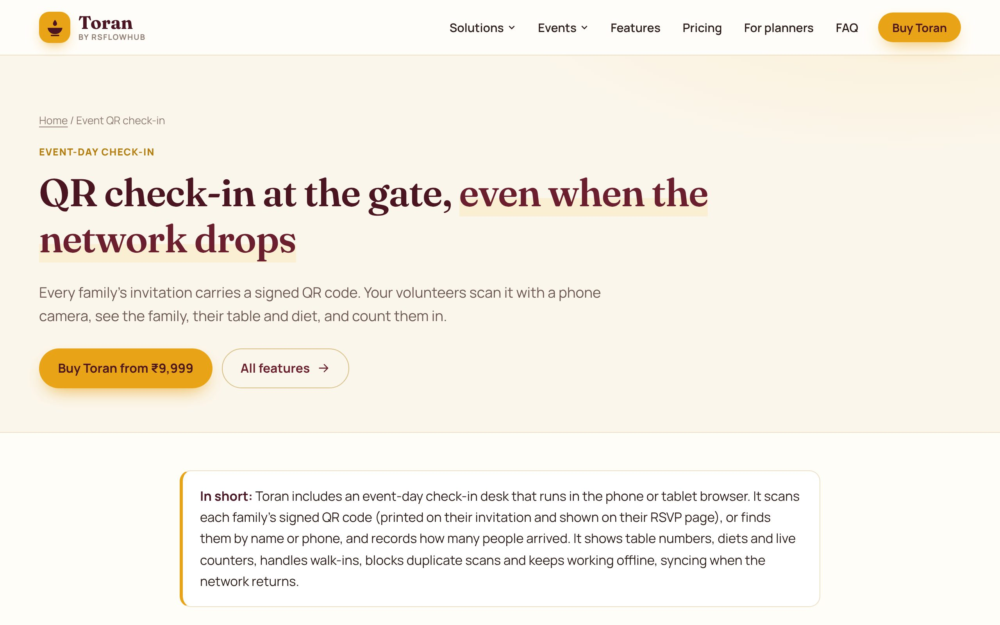
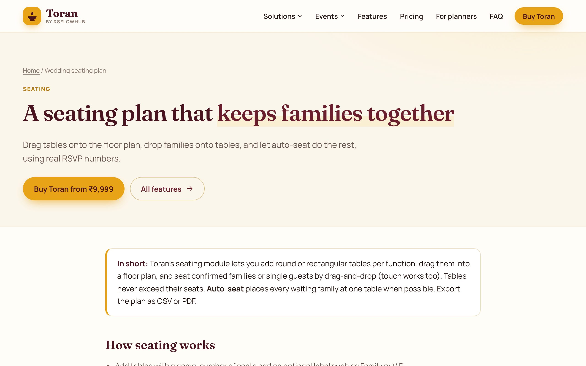

# Toran: Wedding & Event Management Software for Indian Weddings

**Self-hosted wedding planner software. Manage the guest list, RSVPs, WhatsApp invitations, the shagun (chandlo) ledger, seating, vendors and budget, and QR check-in at the gate. Pay once, install it on your own server, and keep every phone number and gift amount private.**

    

> **About this repository:** this repository holds the product page, screenshots and documentation for **Toran**. The software itself is sold as a one-time licence at **[toran.rsflowhub.com](https://toran.rsflowhub.com/?utm_source=github&utm_medium=readme&utm_campaign=toran)**.

---

## Contents

- [What is Toran?](#what-is-toran)
- [Who it is for](#who-it-is-for)
- [Why Toran](#why-toran)
- [Features](#features)
- [Events Toran handles](#events-toran-handles)
- [Screenshots](#screenshots)
- [Pricing](#pricing)
- [Requirements and installation](#requirements-and-installation)
- [What Toran does not do](#what-toran-does-not-do)
- [FAQ](#faq)
- [Buy, demo and support](#buy-demo-and-support)

---

## What is Toran?

**Toran** is **wedding and event management software built for Indian celebrations**. One app holds the whole celebration (Mehndi, Haldi, Sangeet, Lagna, Reception, or any custom function) with:

- **guests and families**
- **RSVP links**
- **WhatsApp invitations**
- the **shagun / chandlo ledger**
- **seating plans**
- **vendors and budget**
- a **QR check-in desk** for the gate

All modules share one guest list. An RSVP updates the seating, the seating shows at the gate, and the shagun shows on the family.

It is **self-hosted**: you buy it once and install it on your own hosting. Every guest phone number and gift amount stays in **your** database. There is **no subscription, no per-guest fee, no per-event fee and no telemetry**.

## Who it is for

- **Families** planning a wedding or a big function themselves
- **Wedding planners and event studios** running many clients' weddings, white-labelled under their own brand
- **Banquet halls, venues and event agencies** that host one copy per client or venue
- **Societies, communities and companies** running garba nights, religious events, reunions and corporate events

## Why Toran

| | Toran | Cloud wedding apps | Excel + notebook |
|---|---|---|---|
| Price | **One-time, from ₹9,999** | Monthly, per event or per guest | Free, but manual |
| Guest phone numbers and shagun | **On your own server** | On the vendor's cloud | Scattered across phones and paper |
| Gujarati, Hindi, Marathi interface | **Yes** | Rarely | n/a |
| WhatsApp invitations and reminders | **Official Meta Cloud API, Twilio or click-to-chat** | Varies | Sent one by one |
| Check-in at the gate | **QR, works offline** | Varies | Guest register |
| Your own brand (planners) | **White-label** | Rarely | n/a |

Full comparison: [Toran vs wedding planning apps](https://toran.rsflowhub.com/compare/toran-vs-wedding-planning-apps?utm_source=github&utm_medium=readme&utm_campaign=toran)

---

## Features

### 🎉 Events and functions
- One celebration (a wedding, janoi, seemant, festival and so on) holds all its functions: Mehndi, Haldi, Sangeet, Lagna, Reception, or your own.
- Each function has a date, start and end time (functions past midnight are handled), venue, address, Google Maps link, dress code and status (Draft, Ready, Done).
- The **dashboard** shows a countdown to the main event, RSVP progress, shagun totals, the timeline, payments due, check-in status, and tasks for your team.

### 👨‍👩‍👧 Guests and families
- Guests are grouped into **families** that are invited together, with one shared RSVP link.
- Each guest has a phone, email, age group, **side (bride, groom or common)**, relation, city, **diet (regular, Jain, other)** and tags.
- **Excel / CSV import** of up to 5,000 rows, with column matching in English, Hindi, Gujarati and Marathi, duplicate checks by phone number, and Excel export.
- More: [Guest management software](https://toran.rsflowhub.com/wedding/guest-management-software?utm_source=github&utm_medium=readme&utm_campaign=toran)

### ✅ RSVP without logins
- Each family gets a **private mobile-friendly RSVP link**, with no app or password.
- Families answer **per function**, with headcount, food preference and a message.
- An RSVP grid for the hosts, manual edits, and **WhatsApp reminders** to families who have not replied.
- More: [RSVP software](https://toran.rsflowhub.com/wedding/rsvp-software?utm_source=github&utm_medium=readme&utm_campaign=toran)

### 💬 WhatsApp invitations
- Sent only through official channels: the **WhatsApp Cloud API (Meta)**, **Twilio**, or free **click-to-chat** links.
- Queue-based throttling, automatic retries, duplicate-send protection, and delivered/read receipts.
- **Opt-out handling** when a guest replies STOP, बंद or બંધ.
- More: [WhatsApp invitations](https://toran.rsflowhub.com/wedding/whatsapp-invitations?utm_source=github&utm_medium=readme&utm_campaign=toran)

### 💌 Invitation designer
- An in-browser designer with text layers, rotation, alignment and font sizes.
- Placeholders: `{guest_name}`, `{family_name}`, `{event_name}`, `{event_date}`, `{venue}`.
- Bundled fonts for **Devanagari and Gujarati** script, so names render correctly.
- Generates a **personalised invitation image for every family**, downloadable one by one or as a ZIP. Each family's **QR check-in code** can be printed on its invitation.

### 💰 Shagun / chandlo ledger
- A digital register for gift money: giver, amount, mode (**cash, UPI, cheque, gift item**), function, receiver and notes.
- Fast entry (type a name, type an amount, press Enter) and a **running total**.
- Totals by function, side and mode. **Excel and PDF export** with Gujarati, Hindi and Marathi names intact.
- Amounts are stored in paise, so totals are always exact.
- More: [Shagun ledger software](https://toran.rsflowhub.com/wedding/shagun-ledger-software?utm_source=github&utm_medium=readme&utm_campaign=toran)

### 🪑 Seating plan
- A **drag-and-drop floor plan** for each function, with round or rectangular tables, seat counts and labels (VIP, Family).
- Over-capacity warnings and an **auto-seat** that keeps families together. CSV and PDF export.
- More: [Seating plan software](https://toran.rsflowhub.com/wedding/seating-plan-software?utm_source=github&utm_medium=readme&utm_campaign=toran)

### 🧾 Vendors and budget
- Vendors in nine categories: caterer, decorator, photographer, venue, music/DJ, makeup, priest, transport and other.
- Agreed amounts, contacts, and quotations and contracts stored securely.
- **Advance and instalment schedules**, direct expenses, a **planned vs spent** budget chart, and reminders for payments due or overdue.
- More: [Budget & vendor tracker](https://toran.rsflowhub.com/wedding/budget-vendor-tracker?utm_source=github&utm_medium=readme&utm_campaign=toran)

### 📲 QR check-in at the gate
- A full-screen **check-in desk on any phone or tablet** browser.
- Scan the family's signed QR code with the camera, or search by name or phone.
- Shows how many people arrived, their table number and diet alerts. Walk-ins are handled and duplicate scans are blocked.
- **Works offline** and syncs when the network returns. A staff role can only use the check-in desk.
- More: [Event QR check-in](https://toran.rsflowhub.com/event-qr-check-in?utm_source=github&utm_medium=readme&utm_campaign=toran)

### 🌐 Languages, branding and security
- Interface in **English, हिन्दी, ગુજરાતી and मराठी**, chosen per user. Tamil, Telugu, Bengali, Kannada, Malayalam and Punjabi are coming soon.
- **White-label** (Planner and Agency plans): your app name, logo, favicon, colours and sign-in page.
- A 15-minute browser installer, system health checks, role permissions (Admin, Planner, Staff), CSRF protection, rate limits and **zero tracking**.

---

## Events Toran handles

Toran is not only for weddings. Each event type has its own page:

[Weddings](https://toran.rsflowhub.com/event-management-software?utm_source=github&utm_medium=readme&utm_campaign=toran) ·
[Destination weddings](https://toran.rsflowhub.com/wedding/destination-wedding-planner-software?utm_source=github&utm_medium=readme&utm_campaign=toran) ·
[Engagement / sagai](https://toran.rsflowhub.com/events/engagement-ceremony-planner?utm_source=github&utm_medium=readme&utm_campaign=toran) ·
[Baby shower / godh bharai / seemant](https://toran.rsflowhub.com/events/baby-shower-godh-bharai?utm_source=github&utm_medium=readme&utm_campaign=toran) ·
[Janoi / thread ceremony](https://toran.rsflowhub.com/events/thread-ceremony-janoi?utm_source=github&utm_medium=readme&utm_campaign=toran) ·
[Naming ceremony](https://toran.rsflowhub.com/events/naming-ceremony-naamkaran?utm_source=github&utm_medium=readme&utm_campaign=toran) ·
[Griha pravesh](https://toran.rsflowhub.com/events/housewarming-griha-pravesh?utm_source=github&utm_medium=readme&utm_campaign=toran) ·
[Birthday parties](https://toran.rsflowhub.com/events/birthday-party-planner?utm_source=github&utm_medium=readme&utm_campaign=toran) ·
[Anniversaries](https://toran.rsflowhub.com/events/anniversary-party-planner?utm_source=github&utm_medium=readme&utm_campaign=toran) ·
[Navratri garba](https://toran.rsflowhub.com/events/navratri-garba-event-management?utm_source=github&utm_medium=readme&utm_campaign=toran) ·
[Religious events](https://toran.rsflowhub.com/events/religious-event-management?utm_source=github&utm_medium=readme&utm_campaign=toran) ·
[Corporate events](https://toran.rsflowhub.com/events/corporate-event-management?utm_source=github&utm_medium=readme&utm_campaign=toran) ·
[Alumni meets & reunions](https://toran.rsflowhub.com/events/alumni-meet-reunion?utm_source=github&utm_medium=readme&utm_campaign=toran) ·
[Event planner software](https://toran.rsflowhub.com/events/event-planner-software?utm_source=github&utm_medium=readme&utm_campaign=toran)

**Across India:** [Gujarat](https://toran.rsflowhub.com/event-management-software-india/gujarat?utm_source=github&utm_medium=readme&utm_campaign=toran) · [Maharashtra](https://toran.rsflowhub.com/event-management-software-india/maharashtra?utm_source=github&utm_medium=readme&utm_campaign=toran) · [Rajasthan](https://toran.rsflowhub.com/event-management-software-india/rajasthan?utm_source=github&utm_medium=readme&utm_campaign=toran) · [Delhi](https://toran.rsflowhub.com/event-management-software-india/delhi?utm_source=github&utm_medium=readme&utm_campaign=toran) · [Punjab](https://toran.rsflowhub.com/event-management-software-india/punjab?utm_source=github&utm_medium=readme&utm_campaign=toran) · [Uttar Pradesh](https://toran.rsflowhub.com/event-management-software-india/uttar-pradesh?utm_source=github&utm_medium=readme&utm_campaign=toran) · [Madhya Pradesh](https://toran.rsflowhub.com/event-management-software-india/madhya-pradesh?utm_source=github&utm_medium=readme&utm_campaign=toran) · [Karnataka](https://toran.rsflowhub.com/event-management-software-india/karnataka?utm_source=github&utm_medium=readme&utm_campaign=toran) · [Tamil Nadu](https://toran.rsflowhub.com/event-management-software-india/tamil-nadu?utm_source=github&utm_medium=readme&utm_campaign=toran) · [Telangana](https://toran.rsflowhub.com/event-management-software-india/telangana?utm_source=github&utm_medium=readme&utm_campaign=toran) · [Kerala](https://toran.rsflowhub.com/event-management-software-india/kerala?utm_source=github&utm_medium=readme&utm_campaign=toran) · [West Bengal](https://toran.rsflowhub.com/event-management-software-india/west-bengal?utm_source=github&utm_medium=readme&utm_campaign=toran) · [Goa](https://toran.rsflowhub.com/event-management-software-india/goa?utm_source=github&utm_medium=readme&utm_campaign=toran) · [all states and UTs →](https://toran.rsflowhub.com/event-management-software-india?utm_source=github&utm_medium=readme&utm_campaign=toran)

---

## Screenshots

| | |
|---|---|
|  **All modules** |  **Shagun ledger** |
|  **WhatsApp invitations** |  **RSVP** |
|  **QR check-in** |  **Seating plan** |

**Invitation designs bundled with Toran:**

| Royal | Pastel | Minimal |
|---|---|---|
|  |  |  |

👉 **See it live:** [book a free demo](https://toran.rsflowhub.com/contact?topic=demo&utm_source=github&utm_medium=readme&utm_campaign=toran)

---

## Pricing

All plans are **one-time payments, GST included**. Every plan includes **every module**. There is **no monthly fee, no per-guest charge and no per-event charge**.

| Plan | Price | Best for | Includes |
|---|---|---|---|
| **Single** | **₹9,999** <s>₹14,999</s> | One family or one business | All modules, 1 installation (one domain), 6 months of updates and email support, 4 languages |
| **Planner** ⭐ | **₹24,999** <s>₹34,999</s> | Wedding planners and event studios | Everything in Single, plus **up to 3 installations**, **white-label branding**, use for your clients' weddings, **free installation**, 12 months of updates and priority email and WhatsApp support |
| **Agency** | **₹49,999** <s>₹69,999</s> | Agencies, venues and banquet groups | Everything in Planner, plus **unlimited installations** for your business and clients, free installation, a 1-hour onboarding call, and 12 months of updates and priority support |

**Add-on for Single:** installation on your server for ₹2,999 (cPanel, Plesk or VPS, including the cron job and a WhatsApp sending test).

- After the update period, Toran **keeps working forever**. Renewing updates is optional.
- **7-day money-back guarantee** if Toran cannot run on hosting that meets the published requirements and support cannot fix it.

### [👉 See pricing and buy Toran](https://toran.rsflowhub.com/pricing?utm_source=github&utm_medium=readme&utm_campaign=toran)

---

## Requirements and installation

- **PHP 8.2+** with `pdo_mysql`, `mbstring`, `intl`, `fileinfo`, `openssl`, `zip`, `xml`, `curl`, `proc_open`, and GD with FreeType or Imagick
- **MySQL 5.7+** or **MariaDB 10.3+**
- **One cron job** that runs every minute
- Runs on **cPanel or Plesk shared hosting**, a **Linux/Windows VPS**, or **Docker**. No Redis, Node.js or SSH needed.

Use the 15-minute browser installer, or let us install it for you.

Guides: [installation](docs/installation.md) · [configuration and WhatsApp setup](docs/configuration.md) · [user guide](docs/user-guide.md) · [customisation](docs/customisation.md) · [upgrade](docs/upgrade.md) · [FAQ](docs/faq.md)

---

## What Toran does not do

- **No video invitations** in version 1.0. Invitations are personalised images.
- There is **no in-app screen to manage team accounts** in version 1.0. Admins create users from the command line.
- It does **not host your data**. Toran runs only on your own server.

---

## FAQ

<b>What is the best wedding management software in India?</b>

If you want a **one-time price**, **Gujarati / Hindi / Marathi** support, **WhatsApp invitations**, a **shagun ledger** and **guest data on your own server**, Toran is built for exactly that.

<b>Is Toran a subscription?</b>

No. You pay once, download the software, and keep using your installed version forever.

<b>Can wedding planners use it for clients?</b>

Yes, on the Planner (up to 3 installations) and Agency (unlimited) plans. Both include white-label branding with your name, logo and colours.

<b>How are WhatsApp invitations sent?</b>

Through the official WhatsApp Cloud API (Meta), Twilio, or free click-to-chat links. Throttling, retries and opt-outs are built in.

<b>Does the RSVP need an app or login?</b>

No. Each family gets a private link that opens on any phone.

<b>Can I try it before buying?</b>

Yes. [Book a guided demo](https://toran.rsflowhub.com/contact?topic=demo&utm_source=github&utm_medium=readme&utm_campaign=toran) and we will walk you through a sample wedding.

More questions: [docs/faq.md](docs/faq.md) · [toran.rsflowhub.com/faq](https://toran.rsflowhub.com/faq?utm_source=github&utm_medium=readme&utm_campaign=toran)

---

## Buy, demo and support

| | |
|---|---|
| 🛒 **Buy** | [toran.rsflowhub.com/pricing](https://toran.rsflowhub.com/pricing?utm_source=github&utm_medium=readme&utm_campaign=toran) |
| 🎥 **Demo** | [toran.rsflowhub.com/contact](https://toran.rsflowhub.com/contact?topic=demo&utm_source=github&utm_medium=readme&utm_campaign=toran) |
| 💍 **For planners** | [toran.rsflowhub.com/wedding/planner-software](https://toran.rsflowhub.com/wedding/planner-software?utm_source=github&utm_medium=readme&utm_campaign=toran) |
| 📧 **Email** | support@rsflowhub.com |
| 🌐 **Company** | [RSFlowHub](https://rsflowhub.com/?utm_source=github&utm_medium=readme&utm_campaign=toran) |

**Also by RSFlowHub:** [CA Vault: practice management software for CA firms](https://github.com/RSFlowHub/ca-vault-practice-management-software)

---

Keywords: wedding management software India, wedding planner software, event management software India, Indian wedding guest list app, wedding RSVP software, WhatsApp wedding invitation software, shagun ledger, chandlo register, wedding seating plan software, wedding budget and vendor tracker, QR check-in for events, self-hosted event management software, white-label wedding planner software, Gujarati wedding software, garba event management.

© 2026 RSFlowHub. Toran is commercial software. This repository contains its product information and documentation only.
